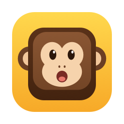
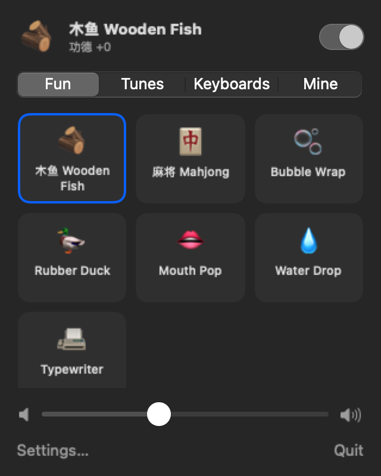
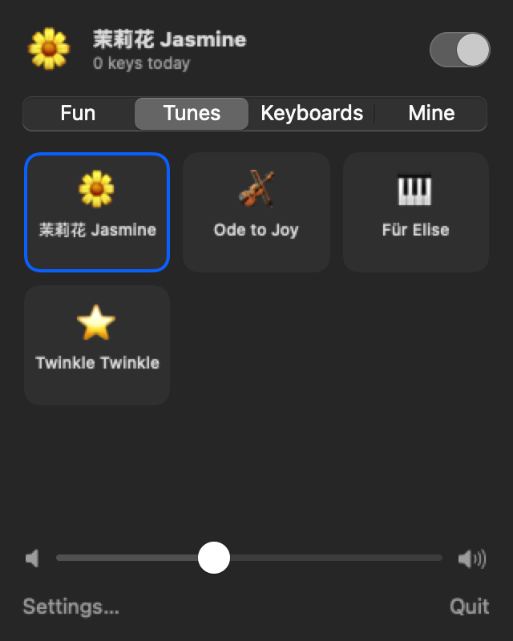
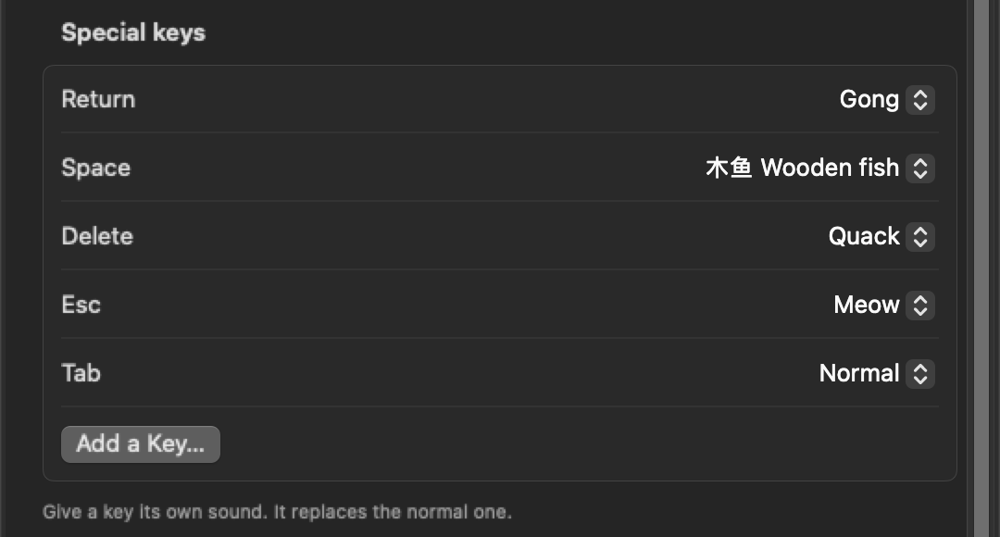

<p align="center"></p>

# Bonkeys

**Your keyboard plays anything.** Bonkeys is a small Mac menu bar app. Every key you press can knock like a wooden fish
(木鱼), clack like mahjong tiles (麻将), pop like bubble wrap, quack like a duck, or play the next note of a song.

<p align="center">
  
  
</p>

[Hear the seven fun packs](docs/sound-preview.m4a) (download to play).

## What it does

- **Fun packs:** 木鱼 wooden fish, 麻将 mahjong, bubble wrap, rubber duck, mouth pop, water drop, typewriter. The wooden
  fish counts your 功德 (merit) as you type.
- **Tunes:** each key plays the next note of 茉莉花 (Jasmine), Ode to Joy, Für Elise or Twinkle Twinkle.
- **Keyboards:** 13 mechanical keyboard switches.
- **Special keys:** put a gong on Return, a meow on Esc, or any of 13 sounds on any key.
- **Your own sounds:** record one, add files, or drop in a whole pack.
- **Feels right:** adjust the sound delay so it lands when the key hits the bottom. Key volume can stay separate from
  your Mac's volume.
- **Knows when to be quiet:** password fields, the lock screen, quiet hours, chosen apps, or while the microphone is in use.

## Install

There is no ready-made download yet, so you build it. You need macOS 15 or later and Xcode 26 or later.

```sh
git clone https://github.com/kevinyu211/bonkeys.git
cd bonkeys
./scripts/build-app.sh --install
open ~/Applications/Bonkeys.app
```

Then click the keyboard icon in the menu bar, click **Allow…**, and turn on Bonkeys under
**System Settings > Privacy & Security > Input Monitoring**. If it still can't hear your keys, click **Relaunch**.

You need to allow it again after every rebuild, because the app isn't signed with an Apple developer certificate.

## Use it

Click the keyboard icon in the menu bar, pick a tab, click a tile, and type.

**Give a key its own sound.** Open **Settings… > Keys > Special keys** and choose a sound. **Normal** puts it back.

<p align="center"></p>

**Record your own.** Open **Settings… > My Sounds** and click **Record**. Click **Use** for the whole keyboard, or pick the
sound under Special keys.

**Make a pack.** Open **Settings… > My Sounds**, click **Open Packs Folder**, and put a folder of audio files in it. Then click
**Reload** and **Use**.

| File name starts with | Plays on |
|---|---|
| `space` | Space |
| `enter` or `return` | Return |
| `delete` or `backspace` | Delete |
| `release` | Any key coming back up |
| anything else | All other keys, picked at random |

Sounds are trimmed, evened out in loudness, and cut at 4 seconds.

**Control it from scripts.** For example, `open bonkeys://toggle`. Also: `on`, `off`, `volume/40`, `switch/muyu`, `settings`.

## Privacy

Bonkeys has to see key presses to play sounds, so here is exactly what it does with them:

- It listens only for the moment a key moves, and cannot change or block your typing.
- It never saves which keys you pressed. It keeps daily totals on your Mac.
- It makes no network connections. Nothing leaves your Mac.
- The microphone is on only while you record a sound.

The code that listens is in [InputTap.swift](Sources/Bonkeys/InputTap.swift).

## Contributing

New sounds and fixes are welcome. See [CONTRIBUTING.md](CONTRIBUTING.md).

## License

The code is [MIT](LICENSE). The fun packs and special-key sounds are cut from CC0 (public domain) recordings. The mechanical
keyboard sounds come from kbsim under MIT. Every source is listed in [CREDITS.md](Resources/CREDITS.md).
